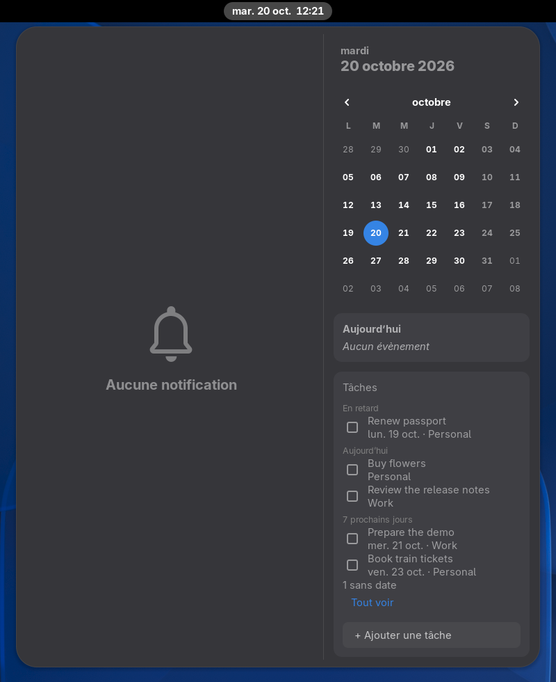
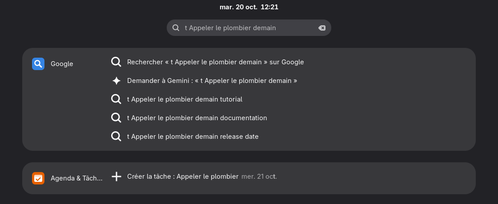

# Google Hub pour GNOME

[](https://github.com/maximeallanic/gnome-google-hub/actions/workflows/ci.yml)
[](LICENSE)
[](docs/installation.md#requirements)

[English](README.md) | Français

**Le côté Google d'un Chromebook, intégré à GNOME Shell.** La recherche et les suggestions Google dans la recherche
de GNOME, Gemini à un raccourci, vos Tâches Google dans le menu de l'horloge, et des questions à la voix transcrites
sur votre propre ordinateur.

<p align="center">
  
</p>

```sh
curl -fsSL https://raw.githubusercontent.com/maximeallanic/gnome-google-hub/main/install.sh | bash
```

GNOME Shell 50 ou 51 sous Wayland. L'installateur demande avant chaque `sudo` et avant de télécharger le modèle
vocal ; [ce qu'il fait](#installation).

> [!NOTE]
> Projet open source indépendant, ni conçu, ni approuvé, ni soutenu par Google. Google, Gemini, Google Agenda,
> Google Tasks et Chrome sont des marques de Google LLC ([NOTICE](NOTICE.md)).

## Pourquoi

Quand votre journée tourne sur Google, un bureau GNOME vous renvoie sans cesse vers des onglets : un pour chercher,
un pour Gemini, un pour voir ce qui est à faire aujourd'hui. ChromeOS met la recherche Google dans son lanceur, votre
agenda et vos tâches dans le panneau de la date. Google Hub fait de même sur GNOME, aux endroits que GNOME a déjà :
la recherche qui s'ouvre avec Super, le menu de l'horloge, la barre du haut.

- **Ni clé d'API, ni projet Google Cloud.** L'Agenda et les Tâches passent par le compte Google ajouté dans
  Paramètres > Comptes en ligne.
- **Votre voix reste sur votre ordinateur.** La parole est transcrite localement par
  [whisper.cpp](https://github.com/ggml-org/whisper.cpp) ; seul le texte part vers Gemini.
- **Aucune télémétrie, aucun serveur à lui.** Ce qui part chez Google est détaillé dans
  [Confidentialité](#confidentialité).

## Ce que vous y gagnez

- **Google là où vous tapez déjà.** Appuyez sur Super et tapez : « Rechercher sur Google », « Demander à Gemini »,
  suggestions Google et adresses directes s'affichent sous vos applications, à côté des favoris et de l'historique
  de Chrome ou Chromium, de vos événements et de vos tâches.
- **Des raccourcis vers les sites que vous cherchez le plus.** `yt`, `maps`, `w` (Wikipédia dans votre langue),
  `gh`, `drive`, et ceux que vous ajoutez.
- **Une tâche en une ligne.** `t Appeler le plombier demain` crée une tâche Google pour demain. Les dates sont lues
  dans la langue de la session, et dans toutes celles que connaît
  [dateparser](https://github.com/scrapinghub/dateparser).
- **Gemini sans onglet.** Super+G fait glisser la vraie application web Gemini depuis le bord droit, déjà chargée,
  avec votre compte et votre historique. Un clic ailleurs la cache. Elle n'apparaît ni dans Alt+Tab, ni dans le
  dock, ni dans la vue d'ensemble.
- **Demander à la voix, en privé.** Super+Maj+G, parlez : la phrase est transcrite sur votre ordinateur et envoyée à
  Gemini. Le bouton micro de Gemini utilise le même moteur local.
- **Les tâches du jour à côté de l'horloge.** Le menu de l'horloge gagne une section Tâches : en retard, aujourd'hui
  et les 7 prochains jours, toutes listes confondues. Cochez pour terminer, ajoutez-en, continuez hors ligne (les
  changements partent au retour du réseau), et recevez un résumé chaque matin.
- **Votre langue.** Interface en anglais et en français pour l'instant ; dates dans la langue de la session ; voix
  dans les langues des modèles multilingues de Whisper.

<table>
  <tr>
    <td></td>
    <td></td>
  </tr>
  <tr>
    <td><br><br></td>
    <td></td>
  </tr>
</table>

<sub>Captures réelles de ce code dans un GNOME Shell 51 imbriqué, avec des données inventées (suggestions factices,
d'où leur tournure étrange ; titres des tâches en anglais) ; le volet est montré déconnecté. Leur fabrication :
[screenshots/README.md](screenshots/README.md).</sub>

## Confidentialité

Google Hub relie votre bureau à Google : une partie de ce que vous faites part donc chez Google. Voici le partage.

| Part chez Google | Reste sur votre ordinateur |
|---|---|
| **Ce que vous tapez dans la recherche de GNOME**, dès trois caractères, vers `suggestqueries.google.com` pour les suggestions. Activé par défaut ; désactivez **Suggestions Google** dans les préférences de l'extension et rien n'est envoyé pendant la frappe. | **Votre voix.** Enregistrée seulement pendant que la pastille « J’écoute… » ou le micro de Gemini est actif, transcrite par `whisper-server` sur `127.0.0.1`, puis effacée. |
| **Les requêtes Agenda et Tâches**, avec le jeton des Comptes en ligne, vers les API Agenda et Tasks de Google. | **Votre historique et vos favoris**, lus depuis une copie locale et comparés localement. |
| **Tout ce que vous faites dans le volet Gemini**, selon les conditions de Google. | **Vos identifiants** : le jeton des Comptes en ligne reste dans la mémoire du démon ; la connexion Gemini est un cookie du profil propre au volet. |
| | **Le cache de vos tâches**, pour que le menu de l'horloge marche hors ligne. |

Aucune télémétrie, aucune mesure d'audience, aucun serveur tenu par ce projet. Le seul autre téléchargement est le
modèle vocal, une fois, depuis Hugging Face, avec vérification de somme de contrôle. Si vous ne voulez pas que votre
frappe de recherche parte chez Google, coupez les suggestions dans les préférences (application Extensions) : la
recherche n'envoie alors rien tant que vous ne choisissez pas « Rechercher sur Google » ou un autre résultat web. Détails :
[docs/privacy.md](docs/privacy.md) (en anglais).

## Prérequis et limites

**Il vous faut**

- GNOME Shell 50 ou 51, session Wayland. Les versions plus anciennes, X11 et les autres bureaux ne sont pas pris en
  charge.
- Debian, Ubuntu, Fedora, Arch ou une dérivée pour l'installation automatique des paquets. Les autres distributions
  fonctionnent avec les [dépendances](docs/installation.md#dependencies) installées à la main.
- Facultatif : un compte Google dans Paramètres > Comptes en ligne (Agenda et Tâches) ; `whisper-server` et environ
  470 Mo pour le modèle vocal (voix).

**À savoir avant d'installer**

- **Seule Debian testing a été essayée pour de vrai.** Les noms de paquets Fedora et Arch sont vérifiés dans les
  index des distributions, pas encore installés lors d'un essai. Les retours d'autres distributions sont très
  bienvenus.
- **Le volet Gemini pilote une page web.** C'est le vrai gemini.google.com, et « Demander à Gemini » y tape votre
  question. Quand Google modifie cette page, l'envoi de la question peut casser jusqu'à la mise à jour des sélecteurs
  de [selectors.js](panel/google_hub_panel/selectors.js).
- **Fedora n'a pas de paquet `whisper-server`.** La voix demande de compiler whisper.cpp une fois
  ([comment](docs/installation.md#dictation-without-a-whisper-server-package)). Tout le reste fonctionne.
- **Pas encore sur extensions.gnome.org.** L'extension a besoin d'un service en arrière-plan et du programme du
  volet, que seul `install.sh` met en place.
- **Favoris et historique viennent des navigateurs de la famille Chromium seulement** (Chrome, Chromium). Firefox
  n'est pas pris en charge.
- **L'installateur ne parle qu'anglais.** L'interface du bureau est en anglais et en français.
- **Première version (0.1.0).** Attendez-vous à quelques aspérités.

## Installation

Depuis un terminal de votre session GNOME, avec votre utilisateur habituel :

```sh
curl -fsSL https://raw.githubusercontent.com/maximeallanic/gnome-google-hub/main/install.sh | bash
```

L'installateur télécharge la version figée et vérifie son sha256, affiche ce qui manque, demande avant d'installer des paquets avec `sudo`
(la seule étape qui l'utilise) et avant de télécharger le modèle vocal, installe tout dans votre dossier personnel
et termine par une vérification. Ensuite :

1. Fermez la session puis rouvrez-la.
2. Paramètres > Comptes en ligne > Google, avec Agenda activé (les Tâches utilisent la même autorisation).
3. Appuyez sur Super+G et connectez-vous une fois à Gemini.

Envie de regarder d'abord ? `git clone https://github.com/maximeallanic/gnome-google-hub && cd gnome-google-hub &&
./install.sh --dry-run`. Paquets par distribution, options et compilation de whisper.cpp :
[docs/installation.md](docs/installation.md) (en anglais).

Vérifier ou désinstaller à tout moment :

```sh
~/.local/share/google-hub/source/verify.sh
~/.local/share/google-hub/source/uninstall.sh     # --purge retire aussi réglages, modèle et connexion Gemini
```

## Utilisation

| Geste | Effet |
|---|---|
| Super, puis taper | Résultats Google, Chrome et Agenda & Tâches sous les applications |
| `yt …`, `maps …`, `w …`, `gh …`, `drive …` | Recherche directe sur ce site |
| `t Acheter du pain vendredi` | Une tâche Google pour vendredi |
| `demain`, `lundi`… | Les événements de ce jour |
| Super+G, ou l'icône étincelle | Ouvrir ou fermer le volet Gemini |
| Super+Maj+G | Demander à Gemini à la voix (de nouveau ou clic : terminer ; Échap : annuler) |
| Menu de l'horloge | Vos tâches ; cocher pour terminer, « + Ajouter une tâche » |

Les raccourcis et la largeur du volet sont des clés GSettings ; `~/.config/google-hub/config.json` règle le modèle
et la langue de la voix, l'heure du résumé, le profil du navigateur et des langues de dates supplémentaires ;
`keywords.json` ajoute des mots-clés de recherche. Plus de détails : [docs/usage.md](docs/usage.md) et
[docs/configuration.md](docs/configuration.md) (en anglais).

## FAQ

**Est-ce fait par Google ?**
Non. C'est un projet indépendant, ni affilié à Google ni approuvé par Google ([NOTICE](NOTICE.md)).

**Faut-il une clé d'API ou un abonnement Gemini payant ?**
Aucune clé. Le volet est l'application web Gemini, avec votre propre compte et l'offre que vous avez déjà.

**Est-ce que ça marche sans compte Google ?**
En partie : suggestions, mots-clés, favoris et historique, volet (déconnecté, avec ce que Google permet alors) et
voix fonctionnent. L'Agenda et les Tâches demandent le compte.

**Qu'est-ce que ça ajoute à ce que GNOME fait déjà ?**
Avec un compte Google dans les Comptes en ligne, GNOME affiche déjà vos événements Google Agenda dans le menu de
l'horloge et dans Agenda de GNOME. Google Hub ajoute ce que GNOME n'a pas : résultats et suggestions Google dans la
recherche, événements et tâches dans la recherche, Tâches Google dans le menu de l'horloge, et Gemini dans le Shell.

**Pourquoi pas une application Gemini de bureau ou une extension Gemini pour la barre ?**
Prenez-en une si c'est une fenêtre séparée ou une discussion dans la barre que vous voulez ; certaines demandent une
clé d'API Gemini. Google Hub ouvre l'application web Gemini que vous utilisez déjà, avec votre compte et votre
historique, dans un volet lié à la recherche de GNOME et au clavier.

**Puis-je dicter dans n'importe quelle application ?**
Non. Ici, la voix sert à interroger Gemini. Pour dicter partout, utilisez un outil de dictée Whisper dédié.

**Pourquoi un service en arrière-plan ?**
Des appels réseau, la capture audio et la reconnaissance vocale à l'intérieur de GNOME Shell figeraient le bureau ;
le démon fait ce travail dans son propre processus.

Plus de réponses : [docs/faq.md](docs/faq.md) et [docs/troubleshooting.md](docs/troubleshooting.md) (en anglais).
`verify.sh` nomme la plupart des problèmes et leur solution.

## Documentation

La documentation détaillée est en anglais : [Installation](docs/installation.md) · [Utilisation](docs/usage.md) ·
[Configuration](docs/configuration.md) · [Dépannage](docs/troubleshooting.md) · [Confidentialité](docs/privacy.md) ·
[FAQ](docs/faq.md) · [Architecture](docs/architecture.md) · [Développement](docs/development.md) ·
[Journal des versions](CHANGELOG.md)

## Aidez-le à progresser

Essayez-le et racontez comment ça s'est passé, surtout sur Fedora, Arch, Ubuntu ou une autre distribution : ouvrez
un [ticket](https://github.com/maximeallanic/gnome-google-hub/issues) avec la sortie de `verify.sh`. Traductions,
correctifs quand la page de Gemini change, et une étoile s'il vous évite quelques onglets : tout est bienvenu. Voir
[CONTRIBUTING.md](CONTRIBUTING.md), [SUPPORT.md](SUPPORT.md) et le [code de conduite](CODE_OF_CONDUCT.md). Problèmes
de sécurité : [SECURITY.md](SECURITY.md).

## Licence et marques

[MIT](LICENSE) © 2026 Maxime Allanic. Mentions des tiers : [NOTICE.md](NOTICE.md).

Google Hub n'est ni affilié à Google LLC, ni approuvé, ni parrainé par Google LLC. Google, Gemini, Google Agenda,
Google Tasks, Google Drive, Google Maps, YouTube et Chrome sont des marques de Google LLC, citées ici uniquement pour
dire avec quoi le logiciel fonctionne. Les icônes livrées avec l'extension sont dessinées pour ce projet ; ce ne sont
pas des logos Google.
