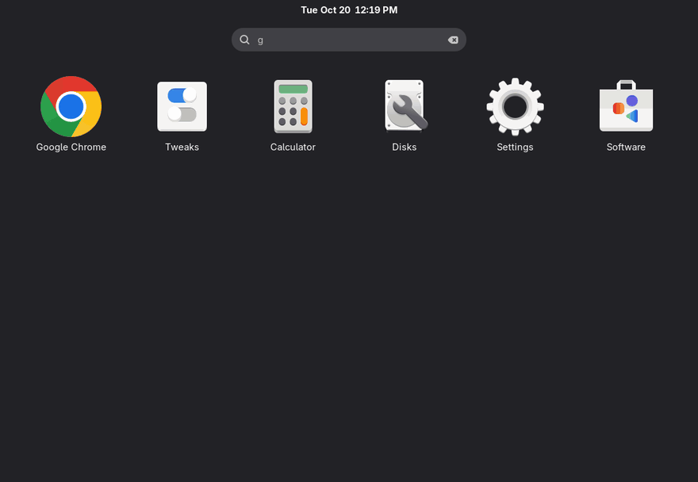
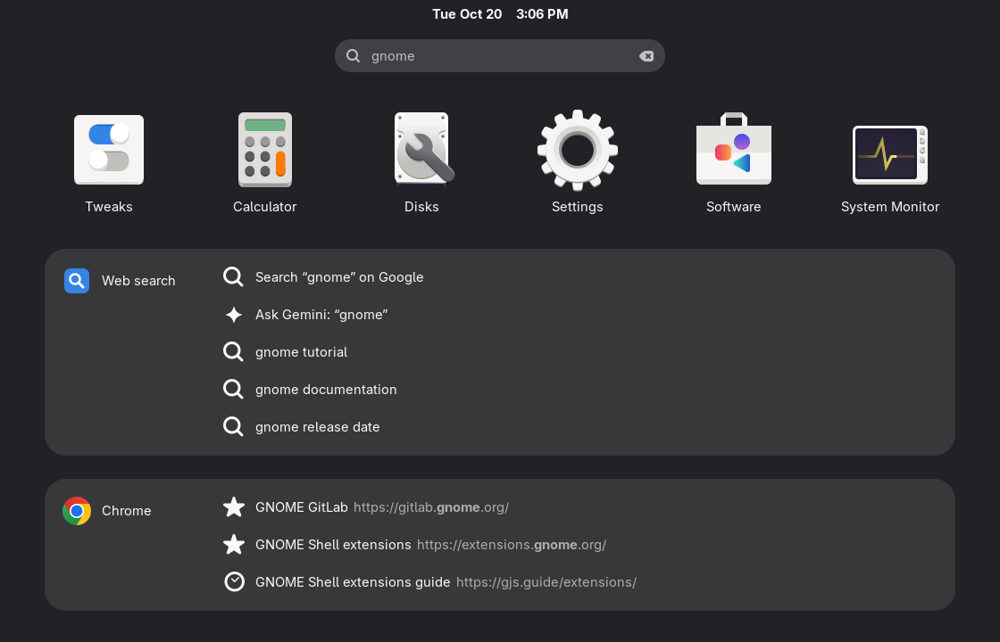
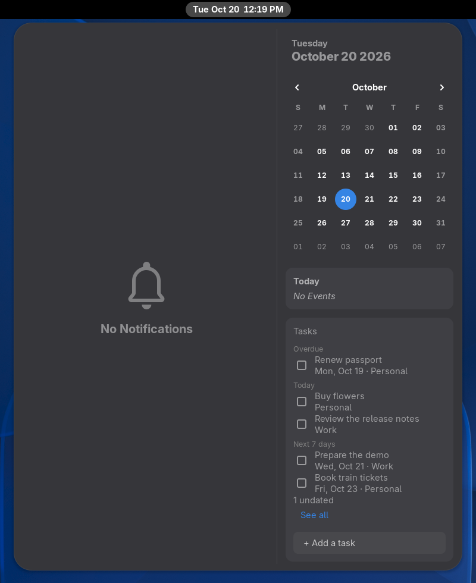
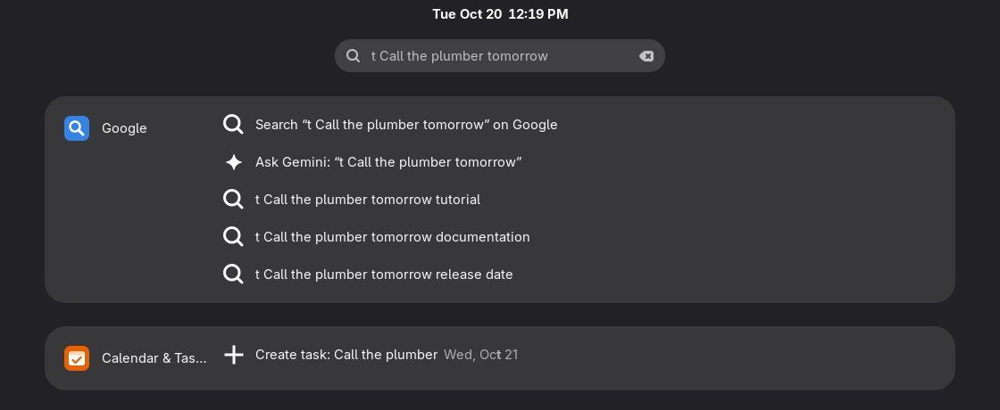
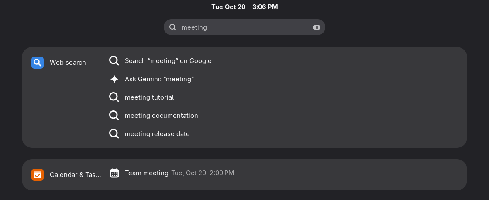
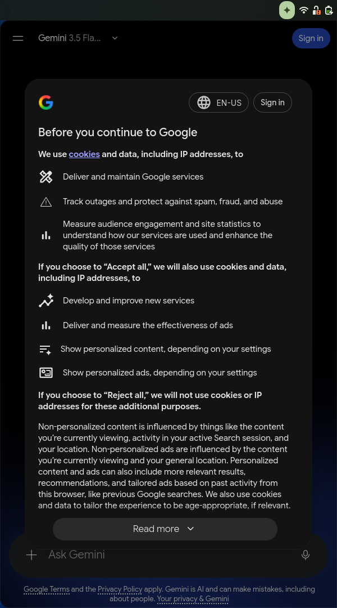

# Omnishell

Search, assistant and tasks for GNOME.

[](https://github.com/maximeallanic/omnishell/actions/workflows/ci.yml)
[](LICENSE)
[](docs/installation.md#requirements)

English | [Français](README.fr.md)

**The Google side of a Chromebook, built into GNOME Shell.** Google search and suggestions in the GNOME search,
Gemini one shortcut away, Google Tasks in the clock menu, and voice questions transcribed on your own computer.

<p align="center">
  
</p>

```sh
curl -fsSL https://raw.githubusercontent.com/maximeallanic/omnishell/main/install.sh | bash
```

GNOME Shell 50 or 51 on Wayland. The installer asks before every `sudo` and before the speech model download;
[what it does](#install).

> [!NOTE]
> Independent open source project, not made, endorsed or supported by Google. Google, Gemini, Google Calendar,
> Google Tasks and Chrome are trademarks of Google LLC ([NOTICE](NOTICE.md)).

## Why

If your day runs on Google, a GNOME desktop keeps sending you back to browser tabs: one to search, one for Gemini,
one to see what is due today. ChromeOS puts Google search in its launcher and your calendar and tasks in its date
tray. Omnishell does the same on GNOME, in the places GNOME already has: the search you open with Super, the clock
menu, the top bar.

- **No API key, no Google Cloud project.** Calendar and Tasks use the Google account you add in Settings > Online
  Accounts.
- **Your voice stays on your computer.** Speech is transcribed locally by
  [whisper.cpp](https://github.com/ggml-org/whisper.cpp); only the text goes to Gemini.
- **No telemetry, no server of its own.** What does go to Google is listed under [Privacy](#privacy).

## What you get

- **Google answers where you already type.** Press Super and type: "Search on Google", "Ask Gemini", Google
  suggestions and direct addresses appear below your applications, next to your Chrome or Chromium bookmarks and
  history and your calendar events and tasks.
- **Shortcuts to the sites you search most.** `yt`, `maps`, `w` (Wikipedia in your language), `gh`, `drive`, and
  any you add.
- **A task in one line.** `t Call the plumber tomorrow` creates a Google task due tomorrow. Dates are read in your
  session language (`t Appeler le plombier demain` in French), and in every language
  [dateparser](https://github.com/scrapinghub/dateparser) knows.
- **Gemini without a tab.** Super+G slides the real Gemini web app in from the right edge, already loaded, with your
  account and history. A click elsewhere hides it. It stays out of Alt+Tab, the dock and the overview.
- **Ask by voice, privately.** Super+Shift+G, speak, and the sentence is transcribed on your computer and sent to
  Gemini. Gemini's own microphone button uses the same local engine.
- **Today's tasks next to the clock.** The clock menu gets a Tasks section: overdue, today and the next 7 days from
  all your lists. Tick to complete, add one, keep working offline (changes are sent when the network is back), and
  get a morning summary notification.
- **Your language.** Interface in English and French so far; dates in the session language; voice in the languages
  of Whisper's multilingual models.

<table>
  <tr>
    <td></td>
    <td></td>
  </tr>
  <tr>
    <td><br><br></td>
    <td></td>
  </tr>
</table>

<sub>Real captures of this code in a nested GNOME Shell 51 with invented data (the suggestions are canned, which is
why they read oddly); the drawer is shown signed out. How they were made:
[screenshots/README.md](screenshots/README.md).</sub>

## Privacy

Omnishell connects your desktop to Google, so part of what you do goes to Google. Here is the split.

| Goes to Google | Stays on your computer |
|---|---|
| **What you type in the GNOME search**, from three characters, to `suggestqueries.google.com` for suggestions. On by default; turn **Google suggestions** off in the extension's preferences and nothing is sent as you type. | **Your voice.** Recorded only while the "Listening…" pill or Gemini's microphone is active, transcribed by `whisper-server` on `127.0.0.1`, then dropped. |
| **Calendar and Tasks requests**, with your GNOME Online Accounts token, to Google's Calendar and Tasks APIs. | **Your browser history and bookmarks**, read from a local copy and matched locally. |
| **Everything you do in the Gemini drawer**, under Google's terms. | **Your credentials**: the Online Accounts token stays in the daemon's memory; the Gemini sign-in is a cookie in the drawer's own profile. |
| | **Your tasks cache**, so the clock menu works offline. |

No telemetry, no analytics, no server run by this project. The only other download is the speech model, once, from
Hugging Face, checksum-verified. If you do not want your search keystrokes sent to Google, switch suggestions off in
the preferences (Extensions app): the search then sends nothing until you pick "Search on Google" or another web
result. Full details: [docs/privacy.md](docs/privacy.md).

## Requirements and limitations

**You need**

- GNOME Shell 50 or 51, Wayland session. Older versions, X11 and other desktops are not supported.
- Debian, Ubuntu, Fedora, Arch or a derivative for automatic package installation. Other distributions work with
  the [dependencies](docs/installation.md#dependencies) installed by hand.
- Optional: a Google account in Settings > Online Accounts (Calendar and Tasks); `whisper-server` and about 470 MB
  for the speech model (voice).

**Know before you install**

- **Only Debian testing has been run for real.** The Fedora and Arch package names are checked against the
  distributions' package indexes, not installed in a test yet. Reports from other distributions are very welcome.
- **The Gemini drawer drives a web page.** It is the real gemini.google.com, and "Ask Gemini" types your question
  into it. When Google changes that page, sending the question can break until the selectors in
  [selectors.js](panel/omnishell_panel/selectors.js) are updated.
- **Fedora has no `whisper-server` package.** Voice needs whisper.cpp built once
  ([how](docs/installation.md#dictation-without-a-whisper-server-package)). Everything else works.
- **Not on extensions.gnome.org yet.** The extension needs a background service and the drawer program, which only
  `install.sh` sets up.
- **Bookmarks and history come from Chromium-family browsers only** (Chrome, Chromium). Firefox is not supported.
- **The installer speaks English only.** The desktop interface is in English and French.
- **First release (0.1.1).** Expect rough edges.

## Install

From a terminal in your GNOME session, as your normal user:

```sh
curl -fsSL https://raw.githubusercontent.com/maximeallanic/omnishell/main/install.sh | bash
```

The installer downloads the pinned release and checks its sha256, shows what is missing, asks before installing packages with `sudo` (the
only step that uses it) and before downloading the speech model, installs everything in your home directory, and
ends with a check. Then:

1. Log out and back in.
2. Settings > Online Accounts > Google, with Calendar enabled (Tasks uses the same permission).
3. Press Super+G and sign in to Gemini once.

Prefer to look first? `git clone https://github.com/maximeallanic/omnishell && cd omnishell &&
./install.sh --dry-run`. Per-distribution packages, options and building whisper.cpp:
[docs/installation.md](docs/installation.md).

Check or remove it at any time:

```sh
~/.local/share/omnishell/source/verify.sh
~/.local/share/omnishell/source/uninstall.sh     # --purge also removes settings, model and Gemini sign-in
```

## Usage

| Do | Get |
|---|---|
| Super, then type | Web search, Chrome and Calendar & Tasks results below the applications |
| `yt …`, `maps …`, `w …`, `gh …`, `drive …` | A direct search on that site |
| `t Buy bread friday` | A Google task due Friday |
| `tomorrow`, `monday`… | That day's events |
| Super+G, or the sparkle icon | Open or close the Gemini drawer |
| Super+Shift+G | Ask Gemini by voice (again or click: stop; Escape: cancel) |
| Clock menu | Your tasks; tick to complete, "+ Add a task" |

Shortcuts and the drawer width are GSettings keys; `~/.config/omnishell/config.json` sets the speech model and
language, the summary hour, the browser profile and extra date languages; `keywords.json` adds search keywords. More
in [docs/usage.md](docs/usage.md) and [docs/configuration.md](docs/configuration.md).

## FAQ

**Is it made by Google?**
No. It is an independent project, not affiliated with or endorsed by Google ([NOTICE](NOTICE.md)).

**Do I need an API key or a paid Gemini plan?**
No key. The drawer is the Gemini web app with your own account and whatever plan you already have.

**Does it work without a Google account?**
Partly: search suggestions, keywords, bookmarks and history, the drawer (signed out, with what Google allows then)
and voice work. Calendar and Tasks need the account.

**What does it add to what GNOME already does?**
With a Google account in Online Accounts, GNOME already shows your Google Calendar events in the clock menu and in
GNOME Calendar. Omnishell adds what GNOME does not have: Google results and suggestions in the search, events and
tasks in the search, Google Tasks in the clock menu, and Gemini in the Shell.

**Why not a Gemini desktop app or a Gemini panel extension?**
Use one if a separate window or a chat in the panel is what you want; some of them need a Gemini API key. Omnishell
opens the Gemini web app you already use, with your account and history, as a drawer tied to the GNOME search and
the keyboard.

**Can I dictate into any application?**
No. Voice here asks Gemini. For system-wide dictation, use a dedicated Whisper dictation tool.

**Why a background service?**
Network calls, audio capture and speech recognition inside GNOME Shell would freeze the desktop; the daemon does that
work in its own process.

More answers: [docs/faq.md](docs/faq.md) and [docs/troubleshooting.md](docs/troubleshooting.md). `verify.sh` names
most problems and how to fix them.

## Documentation

[Installation](docs/installation.md) · [Usage](docs/usage.md) · [Configuration](docs/configuration.md) ·
[Troubleshooting](docs/troubleshooting.md) · [Privacy](docs/privacy.md) · [FAQ](docs/faq.md) ·
[Architecture](docs/architecture.md) · [Development](docs/development.md) · [Changelog](CHANGELOG.md)

## Help it get better

Try it and say how it went, especially on Fedora, Arch, Ubuntu or another distribution: open an
[issue](https://github.com/maximeallanic/omnishell/issues) with the output of `verify.sh`. Translations, fixes
when Gemini's page changes, and a star if it saves you a few tabs are all welcome. See
[CONTRIBUTING.md](CONTRIBUTING.md), [SUPPORT.md](SUPPORT.md) and the [code of conduct](CODE_OF_CONDUCT.md). Security
issues: [SECURITY.md](SECURITY.md).

## License and trademarks

[MIT](LICENSE) © 2026 Maxime Allanic. Third-party notices: [NOTICE.md](NOTICE.md).

Omnishell is not affiliated with, endorsed by or sponsored by Google LLC. Google, Gemini, Google Calendar, Google
Tasks, Google Drive, Google Maps, YouTube and Chrome are trademarks of Google LLC, named here only to say what the
software works with. The icons shipped with the extension are drawn for this project; they are not Google logos.
